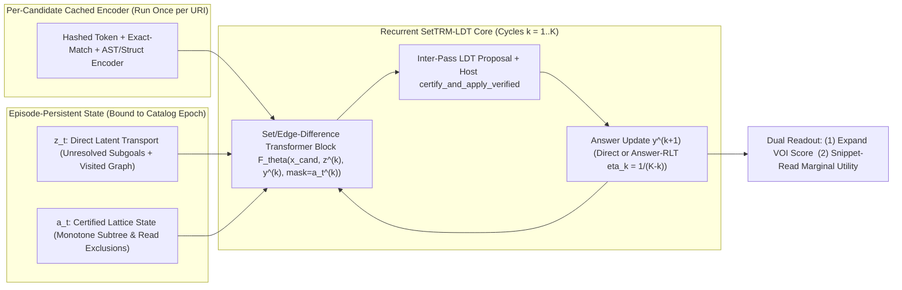
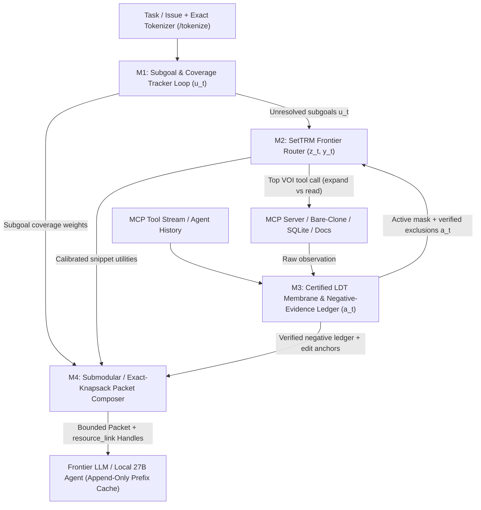

# Token-Efficient MCP Retrieval with Looped Transformers, TRMs, LDTs, and Typed Recurrent Meshes

## 1. Survey of MCP Designs for Token-Efficient Retrieval (2025–2026)

Production Model Context Protocol (MCP `2025-06-18` through `2026-07-28`) deployments face two compounding context bottlenecks:
1. **Upfront discovery bloat:** Eagerly injecting $N$ tool JSON schemas costs $\sim 500\text{–}1,000$ tokens per tool ($>1\text{M}$ tokens on large APIs before turn 1) and invalidates prefix KV caches whenever active toolsets mutate mid-session.
2. **Turn-by-turn observation bloat:** Verbose JSON payloads, whole-file reads, and multi-hop pagination flush intermediate haystack bytes directly into the frontier model's paid context window on every reasoning turn.

Across the broader MCP ecosystem and our implementations in [`MCP/README.md`](README.md), seven architectural patterns address these bottlenecks with distinct authority, latency, and token profiles:

| MCP Design Pattern | Discovery Footprint | Intermediate Observation Path | Representative Ecosystem & Repo Implementations | Primary Failure Mode / Bottleneck |
| :--- | :--- | :--- | :--- | :--- |
| **1. Eager Flat Catalog** (`tools/list` dump) | $O(N_{\text{tools}})$ schemas upfront | Full JSON payloads in LLM context | Naive MCP servers; `flat` arm in [`MCP/environment.py`](environment.py) | Context exhaustion past $\sim 100$ tools; linear prefill tax on every turn |
| **2. Deferred / Active Tool Search** (`defer_loading`, `MCP-Zero`, `RAG-MCP`) | $O(1)$ meta-tools (`search_tools`, `call_tool`) | On-demand schema injection + raw results | Anthropic Tool Search, `MCP-Zero` (`<tool_assistant>`), `search` arm in [`MCP/mcp02/env.py`](mcp02/env.py) | Extra round-trips; lexical/embedding drift on compositional or structural queries |
| **3. Layered / Faceted Index + Certified Pruning** | $O(1)$ traversal tools (`index_children`, `candidate_refine`) | Compact facet sketches; unread subtrees pruned | `layered` & `layered_ldt` arms in [`MCP/mcp02/env.py`](mcp02/env.py) & [`MCP/mcp03/env.py`](mcp03/env.py) | Paging shallow facets exhausts step budgets; directory names alone lack semantic signal (`0.21` file recall without search) |
| **4. Programmatic / Code Mode** (`search()` + `execute()` sandbox) | Fixed $\sim 1\text{K}$ tokens (typed SDK / two meta-tools) | Trapped inside V8/Wasm/Python isolate; only distilled stdout enters context | Cloudflare Code Mode (`search`+`execute`), Anthropic Programmatic Tool Calling, Goose Code Mode | Requires strong code-gen model; untyped scripts can silently drop provenance or over-filter evidence |
| **5. Scoped Handles & `resource_link` Offloading** | $O(1)$ URI templates (`resources/templates/list`) | Returns compact URI handle + digest; slices fetched on demand | MCP `resource_link` blocks, GDK `ToolProvider` projection ([`MCP/ARCHITECTURE.md`](ARCHITECTURE.md)) | Frontier agent still pays multi-turn exploration cost if handles lack calibrated relevance summaries |
| **6. Context-Aware Serialization & MCP Apps Split** | Stable prefix-cached schema | `structuredContent` projections; bulky tables routed to `app-only` UI tools | MCP `2026-07-28` stateless HTTP + MCP Apps; GraphQL field projections | Static server-side schemas cannot know task-specific marginal utility of individual fields/symbols |
| **7. Local Specialist Packet Relay ("Data Goblin" Pattern)** | Zero frontier discovery cost (handled locally) | Local router explores $K$ MCP steps -> hands frontier model **1 bounded verifiable packet** + refs | [`MCP/goose_gdk_app`](goose_gdk_app/README.md), [`MCP/mcp03/goblin_server.py`](mcp03/goblin_server.py), [`MCP/hubrun/proxy.py`](hubrun/proxy.py) | **Current bottleneck:** router under-reads symbol bodies (`0.08–0.22` sym recall) and stateless history compaction drops working-set state |

> [!IMPORTANT]
> **Key Strategic Synthesis:** Pattern 7 (Local Specialist Packet Relay) and Pattern 4/5 (Code Mode + `resource_link` handles) are **complementary, not competing**, layers. A local looped-module mesh (`0.5M–50M` fast router tier or `~1B` DataGoblin specialist tier) should absorb multi-step MCP index/search exploration locally, prune provably irrelevant subtrees via certified LDT checks, and emit a **token-budgeted, provenance-bound context packet + live `resource_link` handles** into an **append-only prefix-cached** frontier prompt.

---

## 2. Empirical Diagnosis Across `HybridTRMLDT/MCP`, `DataGoblin`, and `LoopedTransformers`

Synthesizing recent receipts across `MoralityLabAI/HybridTRMLDT`, `MoralityLabAI/DataGoblin`, and `MoralityLabAI/LoopedTransformers` identifies **three exact code-level bottlenecks** and **four non-negotiable negative-result guardrails**.

### 2.1 Three Structural Bottlenecks in Current MCP & Goblin Code

1. **Action-Type Collapse & Symbol Starvation in `MCP-03` ([`MCP/mcp03/agent.py`](mcp03/agent.py), [`papers/mcp_data_goblin/sections/results.tex`](../papers/mcp_data_goblin/sections/results.tex))**
   - **Measured behavior:** On 109 held-out SWE-bench Lite tasks across 10 unseen repos, `looped_p4_d64` achieves **0.86 gold-file recall in 308 tokens** (beating whole-file BM25's `0.53` at `26,568` tokens — an **86x token reduction** with higher recall, and enabling `goblin-gdk` with Qwen3-4B to resolve `pytest-7373` at `4,039` tokens where `13,430`-token BM25 resolved `0/26`). Yet learned routers achieve only **0.08–0.22 gold-symbol recall** versus **0.41** for BM25+map (`2,048` tokens) and **0.93** for the `layered_ldt` oracle.
   - **Exact code root cause:** In `CodeOracleView.label()` (`MCP/mcp03/agent.py`), *any* `query`, `branch`, `page`, or `doc` candidate that transitively reaches a gold target receives binary label `1` in `_listwise_loss` (`MCP/mcp02/train.py`). In `CodeOraclePolicy.score()`, the oracle breaks ties toward `doc` (`+0.01`), whereas learned routers score `query`, `branch`, `page`, and `doc` on one uncalibrated scale where broad directory/query texts trigger stronger token-match activations. Routers thus spend ~20 of 24 calls expanding queries/branches (populating `seen` for file maps) and read only **1.4–4 symbol bodies** (`reads`).

2. **Stateless Independent Cross-Encoding & Post-Hoc LDT Heads in `MCP-02` ([`MCP/mcp02/models.py`](mcp02/models.py), [`papers/mcp_data_goblin/sections/results_mcp02.tex`](../papers/mcp_data_goblin/sections/results_mcp02.tex))**
   - **Measured behavior:** With the `match` encoder (`+0.26` dev ranking lift over `tokens`), `looped`, `trm`, `trm_ldt`, and `hrm` match a 4-layer Transformer (`0.904–0.915` dev acc) using **0.21–0.41M** non-embedding parameters instead of **0.80M**. At inference, `looped` trained at 4 passes scales monotonically at 1, 2, 4, 8 passes (`25 -> 27 -> 29 -> 30 / 32` on SCB; `19 -> 25 -> 27 -> 28 / 32` on PSCB), **whereas `TRM`, `TRM+LDT`, and `HRM` are completely flat across test depths 1–8** (settling in 1 cycle), and 4x catalog scaling (`256 -> 1024` resources) drops routers from `22–32/32` to `4–23/32` while the oracle hits `26–31/32`.
   - **Exact code root causes:**
     - *Independent candidate forward passes:* `_assemble` (`MCP/mcp02/train.py`) scores each `[CLS] needs [SEP] cand_i` in isolation (`SEQ_LEN <= 74`). Candidates never exchange messages across the frontier, making cross-branch elimination and budget allocation impossible inside the loop.
     - *Per-turn state reset:* `Router.forward` (`MCP/mcp02/models.py`) resets `y = y0 (0)` and `z = z0 (0)` at every MCP tool step instead of persisting `(z_t, a_t)` across the episode.
     - *Post-hoc LDT head:* `exclusion_head` (`MCP/mcp02/models.py`) is a linear readout *after* all TRM cycles complete, rather than an inter-pass lattice projection $\Pi_{a_t^{(k)}}$ inside the recurrence.

3. **Stateless Line-Bag Compaction Destroys Working-Set State in `hubrun` ([`MCP/hubrun/packet.py`](hubrun/packet.py), [`MCP/results/hubrun/README.md`](results/hubrun/README.md))**
   - **Measured behavior:** On local Ternary Bonsai 2 27B (`PTQ1_0`), `compact_messages` prevents 32K context overflows on `event-recon` (`0/5` overflows vs `5/5` raw), **but** causes the agent to re-read dropped files up to `47` times (`1.84x` raw prompt tokens, `0/5` solved) and degrades `doc-edit` from `5/8` (`0.70`) to `1/8` (`0.33`) with `2.9x` stale edit sites. Meanwhile `CHARS_PER_TOKEN = 3.2` undercounts numeric tool outputs, causing `5/5` overflows in the `late` arm.
   - **Exact code root cause:** `compact_messages` ranks middle-turn lines purely by `BM25 + 2.0 * salient_hits` against `task + tail`, lacking typed slots for mutable agent state (files inspected and certified irrelevant, active edit line spans, verified SQL/schema invariants).

### 2.2 Four Empirical Laws & Negative Controls Across `DataGoblin` and `LoopedTransformers`

| Source Study | Key Quantitative Receipt | Mandatory Design Rule for Retrieval Training |
| :--- | :--- | :--- |
| **`DataGoblin` RLT/TRM Supervision** (`docs/rlt_trm_supervision.md`, `docs/one_billion_pretraining_recipe.md`) | Final-only TRM drops to `313/864` at 8 visits; **Stepwise supervision** (`Direct`, `Answer RLT`, `Answer Damping`) hits **`864/864` across depths 4, 6, 8**. Perturbing `z` collapses accuracy (`115/864`) while `y` recovers (`864/864`); RLT on `z` breaks extrapolation (`61/864`). | Keep latent transport `z` **direct** across passes/steps; apply RLT ($\eta_j = 1/(K-j)$) or matched damping **only** to soft answer/score state `y`, and supervise **every intermediate visit** against $k$-step lookahead targets. |
| **`DataGoblin` v15 Edge-Global LDT** (`docs/ldt_edge_exact_correction_v15.md`) | Target-free edge-difference candidate coupling adds **`+0.194`** exact-set accuracy over independent encoders; global exact subset MAP decoding adds **`+0.250`** over factorized decoding (`0.8125` held-out confirmation). | Replace independent candidate scoring (`[CLS] need [SEP] cand_i`) with **permutation-equivariant frontier coupling** (pairwise edge deltas + set attention) and **joint budget-constrained subset decoding** for packets. |
| **`LoopedTransformers` Stopping & Retention** (`CRR`, `AF-33`, `HybridTRMLDT` `rlm_uncertainty_pregate_v0_1`) | Q-halting loses `-0.094` vs best fixed depth under length shift (`0.56–0.72` premature stop); certificate-free `BAL_STOP` hits **`0/768`** via terminal premature stop while `RANK_CERT` (learned ranker + exact closure certificate) hits **`768/768`**; `gated_deterministic_voi` (`0.6124`) beats RLM pregates. | **Never let an uncertified learned `STOP` head terminate retrieval or prune subtrees.** Use learned modules strictly for *ranking and calibrated marginal-VOI estimation*; delegate hard pruning and stopping to `certify_and_apply_verified` + deterministic VOI-vs-token-cost thresholds. |
| **`HybridTRMLDT` RLM-Mesh, `LSAD v1`, & `LoopedTransformers` `B4-CAUSAL-CI-02`** | LLM-wrapped meshes (`rlm_snapshot_mesh_v0_1`) spend `40K–170K` tokens for `0.000` utility gain over fixed consensus; `Qwen2.5-0.5B` JSON controller gets `0/6` at `78.5K` tok/ep; periodic block words (`LSAD v1`) give `\|\Delta\| \le 0.0052`; closed-loop gate training (`B4-CAUSAL-CI-02`) beats open-loop refit by `-3.94` to `-5.59` KL on 64/64 boards. | Compose meshes at the **typed tensor / lattice-state boundary** under a deterministic host dispatcher (never text-wrapped LLM meta-routers); skip arbitrary block-dispatch search; train inter-pass LDT gates **closed-loop** inside the unrolled trajectory. |

---

## 3. Target Architectures: Frontier-Coupled `SetTRM-LDT` & Typed Organelle Meshes

### 3.1 Architecture A: Frontier-Coupled `SetTRM-LDT` Router (`0.4M–5M` Fast Router Tier)

Instead of spending $K$ recurrent passes re-reading a single 74-token `(need, cand_i)` pair in isolation, `SetTRM-LDT` performs **1 lightweight local token/match encoding pass per new candidate** (cached per node URI across turns) and runs **$K$ recurrent `(z, y, a)` cycles over the entire $M$-candidate frontier** ($M \le 64$) plus persistent episode slots:

- **Cross-Candidate Edge Coupling:** Augment each candidate summary vector $x_i \in \mathbb{R}^d$ with target-free frontier edge statistics (mean/max/min signed similarity and structural-depth deltas to sibling candidates in the same server/directory/query page, plus overlap with already-read symbols in `reads`).
- **Inter-Pass Lattice Projection ($\Pi_{a_t^{(k)}}$):** At cycle $k$, `exclusion_head` proposes predicate exclusions (`test_path`, `doc_path`, stale `epoch`, mismatched `scope`/`units`, or *already-covered symbol subtree*). Verified exclusions immediately mask attention keys (`mask_i = False`) for cycles $k+1 \dots K$ and persist in $a_{t+1}$ for the remainder of the catalog epoch.
- **Explicit Action-Type Factoring:** Separate the output head into:
  1. $\hat{v}_{\text{expand}}(i)$: expected downstream recall unlocked by expanding `query` / `branch` / `page` $i$;
  2. $\hat{v}_{\text{read}}(i)$: expected marginal packet utility per token $\Delta U(i) / \text{tok}(i)$ from calling `read_symbol` / `evidence_read` on leaf $i$.

### 3.2 Architecture B: `GoblinMesh-v1` — Typed 4-Organelle Looped Mesh (`10M–50M` Local Mesh or `~1B` Specialist)

To handle both **cold-start repository/catalog retrieval (`MCP-02/03`)** and **multi-turn agent history compaction (`hubrun`)** without the `hubrun` re-read pathology or `RLM-Mesh` wrapper failures, wire four looped modules through typed state buffers coordinated by a deterministic host state machine:

| Mesh Organelle | Recurrent Structure & State | Specific Problem Solved |
| :--- | :--- | :--- |
| **M1: Subgoal & Coverage Loop (`u_t`)** | 2-block looped encoder with query-conditioned binding (`ROC-04B` pattern); tracks $S \le 8$ explicit subgoal slots (`need_terms`, traceback frames, schema joins) and marks coverage $\in [0,1]^S$ as snippets arrive. | Prevents `MCP-03` routers from repeatedly querying already-localized files while leaving secondary issue symbols unread. |
| **M2: Frontier `SetTRM` Router (`z_t, y_t`)** | Shared 4–10 block stack (`DataGoblin` 1B recipe ratio: ~5:1 reasoning `z` to answer `y` capacity); `z_t` carries episode graph directly; `y_t` refines candidate VOI over $K$ cycles. | Scales to 1,024–10,000+ resource catalogs by comparing sibling branches jointly rather than scoring isolated 74-token strings. |
| **M3: Certified LDT & Negative-Evidence Ledger (`a_t`)** | Inter-pass proposer gated by `certify_and_apply_verified` + deterministic digest store of *inspected-and-empty/irrelevant* URIs and *active edit line anchors*. | Fixes `hubrun` `event-recon` (`47` re-reads) and `doc-edit` (`2.9` stale sites): compacted packets retain a compact `[Verified negative / already-read]` block and `[Active edit spans]` slot. |
| **M4: Knapsack Packet Composer** | Edge-coupled set scorer (`DataGoblin` v12/v15) + greedy-submodular / Lagrangian knapsack solver under **exact** server tokenization (`tokenizer.json` / `/tokenize`). | Replaces independent score sorting and `CHARS_PER_TOKEN=3.2` with redundancy-penalized joint selection over `{file_map, symbol_snippets, edit_anchors, negative_ledger, resource_links}`. |

---

## 4. Five Concrete Training Strategies for Token-Efficient Retrieval

### Strategy 1: Counterfactual Marginal-VOI & Budget-Knapsack DAgger (Fixes `MCP-03` Symbol Starvation)

Replace binary transitive imitation (`CodeOracleView.label(c) \in \{0,1\}`) in `MCP/mcp02/train.py` with **counterfactual marginal packet value per token** collected on-policy via DAgger:

1. **Packet-Level Potential Function:** For current read set $R_t$, seen map $M_t$, and target packet token budget $B \in \{512, 1024, 2048, 4096\}$, define the exact knapsack packet value on training repositories (`django`, `sympy`, plus synthetic `MCP-02` worlds across **mixed catalog sizes `{128, 256, 1024, 4096}`**):
   $$U(R_t, M_t; B) = \alpha_{\text{file}} \cdot \text{Recall}_{\text{file}}\!\big(\text{Pack}(R_t, M_t, B)\big) + \alpha_{\text{sym}} \cdot \text{Recall}_{\text{sym}}\!\big(\text{Pack}(R_t, M_t, B)\big)$$
   with $\alpha_{\text{sym}} = 3\,\alpha_{\text{file}}$ once $\text{Recall}_{\text{file}} \ge 0.80$.
2. **Rollout-Backed Marginal Labels:** At state $S_t$ with remaining call budget $H_{\text{rem}} = T_{\max} - t$:
   - For a `read_symbol` (`doc`) candidate $c$: $\Delta U(c \mid S_t, B) = \frac{U(R_t \cup \{c\}, M_t; B) - U(R_t, M_t; B)}{\log_2(16 + \text{tok}(c))}$. Already-covered symbols get $\Delta U = 0$; gold symbols not yet in $R_t$ get immediate positive gain.
   - For an `expand` (`query`/`branch`/`page`) candidate $c$: $\Delta U(c \mid S_t, B) = \gamma \max_{c' \in \text{Children}(c)} \Delta U(c' \mid S_{t+1}, B)$ if $H_{\text{rem}} \ge 2$, and **$0$ when $H_{\text{rem}} = 1$** (forcing the router to switch from searching to reading symbols as remaining calls shrink).
3. **DAgger Relabeling:** Train Round 0 on $\varepsilon$-oracle rollouts ($\varepsilon \in \{0, 0.25, 0.5\}$), then run the learned router on `train` repos (`django`, `sympy`), relabel every visited frontier with $\Delta U(c \mid S_t, B)$, and fit a temperature-scaled KL / Plackett-Luce listwise loss over normalized $\Delta U$ targets plus calibrated Huber regression on $\hat{v}(c) \approx \Delta U(c)$.

### Strategy 2: Multi-Horizon Stepwise + Answer-RLT Supervision with Closed-Loop LDT Unrolling (Fixes TRM/LDT Depth Flatness)

Directly apply the causal laws from `DataGoblin` (`docs/rlt_trm_supervision.md`) and `LoopedTransformers` (`CRR`, `B4-CAUSAL-CI-02`) to make extra recurrent cycles perform genuine multi-hop lookahead:

1. **$k$-Hop Bellman Targets per Recurrent Cycle:** Supervise intermediate answer states $y^{(k)}$ ($k = 1 \dots K$) against **$k$-hop lookahead value targets** $V^{(k)}(c \mid S_t)$ (computed offline on `train` index trees via exact $k$-step subtree backup, mirroring `LDT-RED03`'s exact host-DP supervision):
   - Cycle $k=1$ supervises immediate lexical/signature match ($V^{(1)}$);
   - Cycles $k=2 \dots K$ supervise cross-candidate redundancy elimination, multi-server join completion (`MCP-02` arithmetic across branches), and subtree exhaustion ($V^{(k)}$).
2. **Direct `z` Transport + Answer-RLT on `y` + Randomized Pass Truncation:**
   - Update $z^{(k+1)} = F_\theta(x, y^{(k)}, z^{(k)}, \text{mask}=a_t^{(k)})$ **directly** (no damping on $z$, preserving long-horizon state).
   - Update $y^{(k+1)} = y^{(k)} + \eta_k \big(G_\theta(y^{(k)}, z^{(k+1)}) - y^{(k)}\big)$ comparing $\eta_k = 1$ (`Stepwise Direct`) against $\eta_k = \frac{1}{K - k + 1}$ (`Stepwise Answer-RLT`) with randomized training depths $K \sim \text{Uniform}\{2, 4, 6, 8\}$ and truncated BPTT across episode turns (`detach` $z_t$ every $m=4$ tool steps with $0.5$ probability, training native state continuation so `z_t` avoids `CRR`'s `-0.055` cold-freeze degradation).
3. **Closed-Loop Inter-Pass LDT Gate Training (`B4-CAUSAL-CI-02` Lesson):**
   - Execute `certify_and_apply_verified` **inside the forward pass during training**: when `exclusion_head(z^{(k)})` proposes predicates that the environment checker accepts, mask those candidates *before* cycle $k+1$ runs so $F_\theta$ co-adapts to reasoning over the post-projection frontier $\Pi_{a_t^{(k)}}(C_t)$. Penalize rejected (false-exclusion) proposals with an explicit verification-waste margin loss.

### Strategy 3: Variable-Loop Teacher Distillation & Depth-Rescue Preferences (Inkling / Bonsai -> Compact Mesh)

Extend `DataGoblin`'s `docs/inkling_variable_loop_gym.md` directly to hard ambiguous retrieval and working-set compaction states:

1. **Stage Hard Frontier & Compaction States Across Teacher Loop Depths:**
   - Extract `train`-split retrieval states where `BM25` and `1-pass` routers fail (e.g., indirect traceback cause in an imported base class, or `doc-edit` / `event-recon` multi-turn compaction checkpoints).
   - Run the variable-loop teacher (`TML-d24-varloop-research` at passes $p \in \{1, 2, 3, 5, 7, 10\}$ on a memory-suitable host, or local `Ternary-Bonsai-2-27B` with reasoning budgets $\{0, 512, 1536, 4096\}$) to propose `(next_mcp_queries, symbol_reads, compacted_working_set)`.
2. **Three Checked Export Lanes (Environment-Verified Only):**
   - **Shallowest-Verified SFT (`sft.jsonl`):** Train `GoblinMesh` (`M1` query generator + `M4` compactor) on the *lowest teacher pass $p^*$* whose resulting packet passes the exact downstream verifier (`Recall_sym >= 0.8` or verified `doc-edit` diff pass).
   - **Depth-Rescue Preference Pairs (`preferences.jsonl`):** Whenever pass $p_{\text{high}}$ succeeds on the exact same staged state where pass $p_{\text{low}} < p_{\text{high}}$ failed, train `M2` (`SetTRM`) and `M4` with margin/DPO ranking loss $S(a_{p_{\text{high}}}) - S(a_{p_{\text{low}}}) \ge \delta$, distilling *deep-pass reasoning rescues* into fewer student passes.
   - **Repair Traces (`repairs.jsonl`):** Train `M1/M4` to map `(insufficient_packet_p_low, missing_evidence_symptom)` -> `targeted_followup_read`, teaching iterative packet repair without full-file re-reads.

### Strategy 4: Certificate-Gated VOI Stopping & Submodular Working-Set Compaction (Fixes `AF-33`, `CRR`, & `hubrun`)

Eliminate uncertified halting failures (`AF-33` `BAL_STOP` `0/768`, `CRR` premature halt) and `hubrun` amnesia:

1. **Never Train a Bare Binary `STOP` Classifier:** Train `M2` with pinball/quantile loss ($\alpha = 0.75$ optimistic upper confidence bound) to predict **calibrated remaining marginal gain** $\hat{q}_{0.75}(\Delta U_{\max}(S_t, B))$.
2. **Deterministic Host Stopping & Allocation Rule (`RANK_CERT` + `gated_deterministic_voi`):**
   - **Hard stop** immediately if `M3`'s host-checked lattice `a_t` certifies an empty remaining candidate set or complete subgoal satisfaction (`certify_and_apply_verified`).
   - **Economic VOI stop** otherwise when $\hat{q}_{0.75}(\Delta U_{\max}(S_t, B)) < \lambda_{\text{step}}$, where $\lambda_{\text{step}}$ is calibrated on `dev` (and frozen before `test`, per `MCP/PROTOCOL.md` Stage B) to maximize downstream utility minus local latency/token cost.
   - **Dynamic Test-Time Loop Allocation:** Run `SetTRM` for $k=2$ passes by default; allocate $k=4 \to 8$ passes **only** when top-2 frontier candidates have narrow score margin $|s_{(1)} - s_{(2)}| < \tau$ *and* distinct subtrees (disagreement-triggered recurrence).
3. **Structured 4-Slot `GoblinPacket v2` for `hubrun` (`M4`):**
   - Replace `CHARS_PER_TOKEN = 3.2` with exact `/tokenize` (`llama-server` or `tokenizers`).
   - Partition the compaction budget $B$ into four typed, non-evictable sub-ledgers before filling BM25/SetTRM evidence lines:
     1. `Action & Negative-Evidence Ledger` ($\le 15\%\,B$): compact digest of every prior tool call **plus** verified outcomes (`path/file.py: read lines 1-120 -> 0 matches for X; DO NOT re-read`);
     2. `Active Working-Set / Edit State` ($\le 35\%\,B$): exact current versions + line numbers of any file/row modified or queued for edit (fixes `doc-edit` stale sites);
     3. `Ranked File/Resource Map + resource_link Handles` ($\le 15\%\,B$): top paths + byte/line ranges for targeted re-fetch;
     4. `Submodular Snippet Payload` ($\ge 35\%\,B$): jointly decoded symbol snippets maximizing subgoal coverage minus token redundancy (`DataGoblin` v12/v15 global objective).

### Strategy 5: Replay-Accelerated Group-Relative RL (`GRPO` / `RLOO`) on Failure-Inclusive Token Economics

Once `S1–S4` warm-start the mesh, optimize the end-to-end Data Goblin objective from [`MCP/mcp02/economics.py`](mcp02/economics.py):

1. **Group Rollouts on Fast Bare-Clone / Synthetic Envs:** Sample $G = 8$ retrieval trajectories $\{\tau_1, \dots, \tau_G\}$ per training issue/world from `SetTRM-LDT` (`MCP-03` bare-clone AST cache runs in milliseconds per episode without Docker).
2. **Two-Tier Verifiable Reward $R(\tau)$:**
   - *Inner-loop fast reward (every step):* Exact packet recall + localization sufficiency of a frozen local reader (`Qwen3-4B` or `Bonsai-27B` log-likelihood of gold edit locations given ONLY `Packet(\tau)`), penalized by exact packet tokens and local calls:
     $$R(\tau) = \mathbb{I}[\text{AllGoldFiles}] + 2.0\,\text{Recall}_{\text{sym}}(\tau) + \beta\,\log p_{\text{reader}}(\text{gold\_edit\_span} \mid \text{Packet}(\tau)) - \lambda_{\text{pkt}}\frac{\text{Tok}(\text{Packet}(\tau))}{B} - \lambda_{\text{loc}}\frac{\text{Calls}(\tau)}{T_{\max}}$$
   - *Outer-loop periodic audit (`train` split only):* Periodically score patches generated from `Packet(\tau)` in the sandboxed test runner; fold failed trajectories back as explicit hard negatives.
3. **Group-Relative Advantage (`RLOO` / `GRPO` without a brittle value network):** Update `SetTRM-LDT` policy logits with leave-one-out baseline $A_g = R(\tau_g) - \frac{1}{G-1}\sum_{j \ne g} R(\tau_j)$, clipped importance ratios, KL regularization to the `S1+S2` checkpoint, and **hard safety clamp**: `certify_and_apply_verified` remains in the environment dispatch path so RL exploration can never forge provenance or violate LDT monotonicity.

---

## 5. Prioritized Execution Roadmap & Preregistered Promotion Gates

Ordered strictly cheapest-first so each stage falsifies one bottleneck before scaling compute:

| Phase | Target Repo & Scope | Compute Footprint | Primary Falsifiable Gate (Held-Out) |
| :--- | :--- | :--- | :--- |
| **P1: Read-Aware Marginal-VOI DAgger (`S1`)** | `HybridTRMLDT/MCP/mcp03` (`train`: django+sympy 160; `test`: 109 SWE-bench Lite unseen repos) | Laptop CPU / single GPU (`<30 min`, `<1 GB` RSS) | On 109 held-out tasks at **1,024 tokens**: `Recall_sym > 0.41` (beating 2K-token composed BM25 in half the tokens) while preserving `Recall_file >= 0.85` (`papers/mcp_data_goblin/sections/next_experiment.tex`). |
| **P2: Frontier-Coupled `SetTRM-LDT` + Stepwise/Answer-RLT (`S2`)** | `HybridTRMLDT/MCP/mcp02` (mixed `256 + 1024` train worlds -> `1024` & `4096` held-out worlds) | Single GPU (`~1 hr`, `<2 GB` VRAM) | (a) Positive monotonic test-time depth slope for `SetTRM-LDT` across `cycles = 1, 2, 4, 8` (reversing MCP-02 flatness); (b) `>= 26/32` accepted on 1024-resource layered worlds (closing the 4x scale gap); (c) `0` false LDT exclusions. |
| **P3: `GoblinPacket v2` Working-Set Compactor (`S4`)** | `HybridTRMLDT/MCP/hubrun` (`doc-edit`, `event-recon` tier 1, `mcp-sqlite` on local Bonsai 27B) | Overnight single-GPU (`11 GB` VRAM lease) | Exact `/tokenize` (`0` context overflows across all arms); `doc-edit` goblin arm recovers `>= 5/8` (matching/beating raw at lower peak context); `event-recon` re-read count drops `< 5` per episode. |
| **P4: Inkling / Bonsai Variable-Loop Rescue Distillation + RLOO (`S3 + S5`)** | `DataGoblin` (`inkling` stage/score) -> `GoblinMesh-v1` -> `MCP/mcp03/swebench_e2e` | 24–48 GB teacher capture + single-GPU student fit | Beat `S1+S2` router on held-out calibration at matched FLOPs; downstream SWE-bench harness resolves strictly more issues per $10^5$ frontier input tokens than 13K-token whole-file BM25 and Goose Code Mode alone. |
